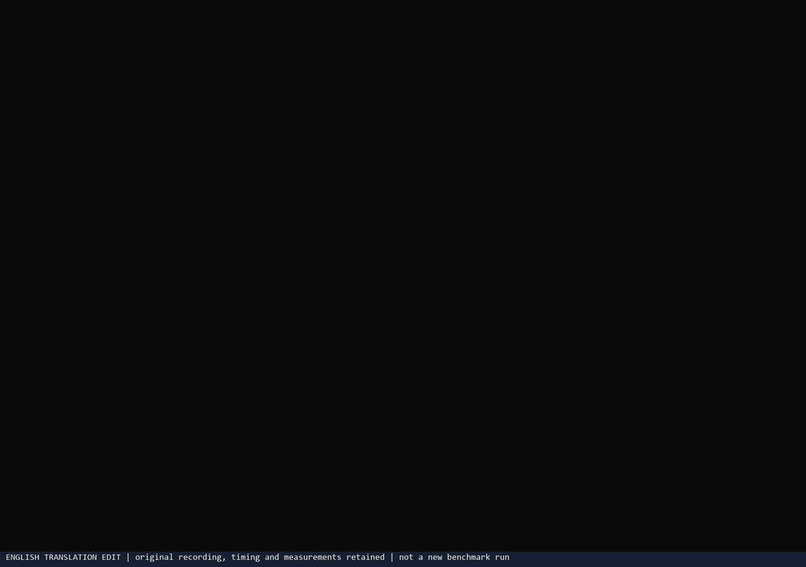
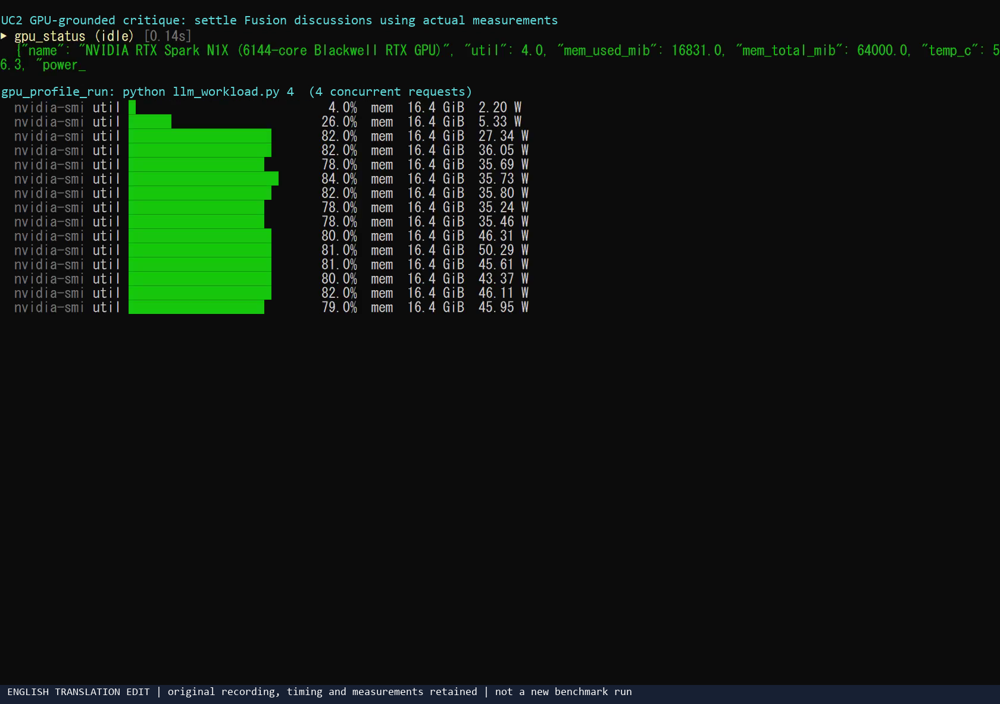
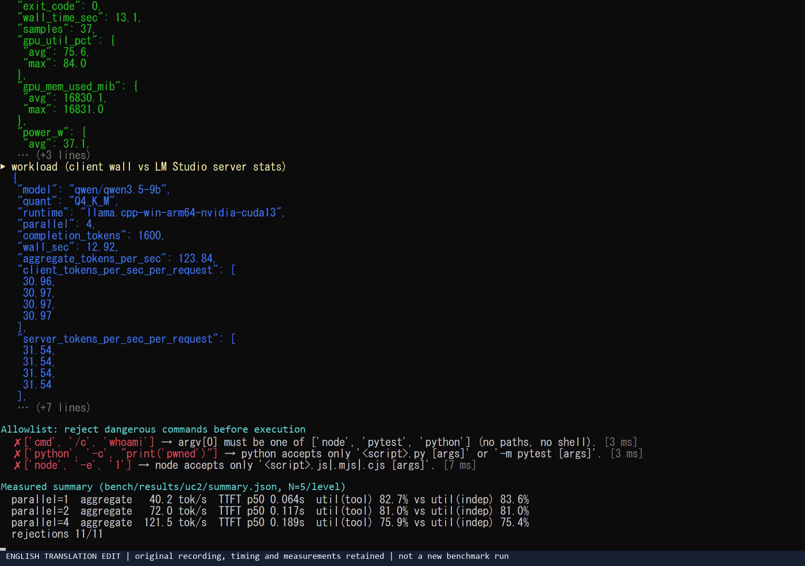
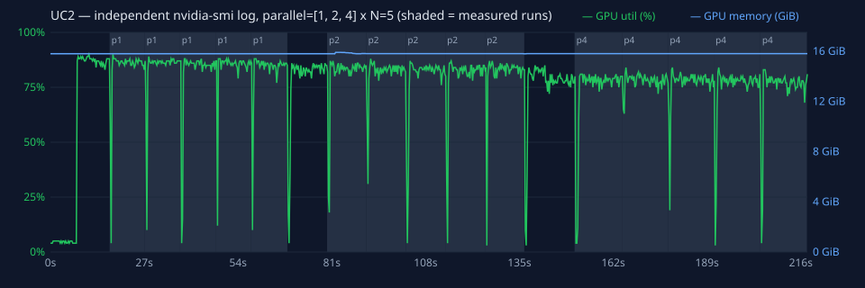

# UC2. GPU-Grounded Critique — Optimize with Measurements, Not Guesswork

[日本語](uc2-gpu-grounded-critique.md) | English

## In a nutshell

Run benchmarks or tests through `gpu_profile_run`, measuring **GPU utilization, memory, temperature, power, and execution time** with `nvidia-smi`. Copilot Fusion Max's Critique loop decides whether to keep or revert a change based only on these measurements.

## Why engineers get excited

- **Structurally prevent “AI said it would be faster, but it got slower.”** Measure every change under the same conditions and judge before/after numbers, so plausible but incorrect suggestions do not survive.
- **Run an autonomous optimization loop on your local Blackwell GPU.** Repeat hypothesis → change → measurement → accept/reject up to 3 times; the human only needs to check the final result and supporting numbers.
- **See how the GPU is used.** In addition to execution time, average and peak utilization and peak memory help identify likely causes such as an idle GPU or insufficient memory.
- **Tune for unified memory.** On RTX Spark, where CPU and GPU share memory, test the effects of batch size, quantization, and context length on real hardware.

## Good fits

- Increasing local LLM inference tokens/sec (batching, quantization, prompt length, concurrency)
- Optimizing PyTorch / CUDA kernels
- Speeding up test suites or training steps
- Regression checks: “Did this change increase GPU memory usage?”

## What you use

| Category | Details |
|---|---|
| Fusion effort | **Max** (the Critique pattern uses another model to critique proposals using measured values) |
| spark-vibe tools | `gpu_status`, `gpu_profile_run` |
| Local model | Not required (the program being measured uses the GPU) |
| Prompt | [`/uc2-gpu-grounded-critique` — Japanese prompt source](../../.github/prompts/uc2-gpu-grounded-critique.prompt.md) |

## Workflow

```
[1] gpu_status       ── Record initial GPU state (check for other workloads)
[2] gpu_profile_run  ── Measure the baseline
        │
   ┌────▼──────────────────────────────────────────────────────────┐
   │ [3] Form 1 hypothesis and make only 1 change                  │
   │ [4] Remeasure with gpu_profile_run and create a delta table   │  Up to 3 times
   │ [5] Decide using numbers only; revert if worse                │
   └────┬──────────────────────────────────────────────────────────┘
[6] Report the changes kept and the numbers supporting them
```

Only one change is made at a time so the numbers can isolate which change had an effect.

## How to use it

### Preparation: register folders approved for measurement

`gpu_profile_run` runs only scripts and tests inside allowed folders (`SPARK_PROFILE_ROOTS`). By default, only this kit's folder is allowed. Register your own project before measuring it.

```powershell
pwsh -File .\scripts\setup.ps1 -ProfileRoots C:\src\my-inference-app -SkipModelLoad
```

To use a project-specific venv, add `SPARK_PROFILE_PYTHON` to `spark-vibe.env` in `mcp.json` / `mcp-config.json`.

```json
"env": {
  "SPARK_PROFILE_ROOTS": "C:\\Work\\Temp\\spark-fusion-vibe;C:\\src\\my-inference-app",
  "SPARK_PROFILE_PYTHON": "C:\\src\\my-inference-app\\.venv\\Scripts\\python.exe"
}
```

Restart the MCP server after changing the settings (in VS Code: **MCP: List Servers** → `spark-vibe` → **Restart**).

### VS Code

1. In the model picker, select **Copilot Fusion**, effort **Max**.
2. Enter `/uc2-gpu-grounded-critique` in chat.
3. Fill in:
   - `target`: what you want to optimize (for example, “Increase tokens/sec in `bench_llm.py`”)
   - `argv`: the command as an **array** (for example, `["python", "bench_llm.py"]`)
   - `cwd`: the working folder's **absolute path** (for example, `C:\Work\Temp\spark-fusion-vibe\demo`)

### Allowed command forms

| Form | Example |
|---|---|
| Python script | `["python", "bench.py", "--batch", "8"]` |
| pytest (module invocation) | `["python", "-m", "pytest", "tests/test_perf.py", "-q"]` |
| pytest | `["pytest", "-k", "fast", "tests"]` |
| Node.js script | `["node", "bench.mjs"]` |

`cmd`, `powershell`, `.exe` paths, `python -c`, `node -e`, and pytest options that load external code are rejected. See the [security model](../security.en.md#gpu_profile_run-allowlist) for details.

## Demo execution example

`demo/bench_llm.py` is a benchmark that asks the local LLM to generate 400 tokens and prints tokens/sec.

Call:

```json
{ "argv": ["python", "bench_llm.py"], "cwd": "C:\\Work\\Temp\\spark-fusion-vibe\\demo", "interval_sec": 0.3 }
```

Actual result (run on this device on 2026-11-10; values vary between runs):

```json
{
  "argv": [
    "C:\\Work\\Temp\\spark-fusion-vibe\\.venv\\Scripts\\python.exe",
    "C:\\Work\\Temp\\spark-fusion-vibe\\demo\\bench_llm.py"
  ],
  "exit_code": 0,
  "wall_time_sec": 10.125,
  "samples": 25,
  "gpu_util_pct": { "avg": 84.5, "max": 89.0 },
  "gpu_mem_used_mib": { "avg": 16114.0, "max": 16114.0 },
  "temp_c": { "avg": 65.2, "max": 68.24 },
  "power_w": { "avg": 35.7, "max": 46.03 },
  "output_tail": "{\"model\": \"qwen/qwen3.5-9b\", \"completion_tokens\": 400, \"seconds\": 9.94, \"tokens_per_sec\": 40.2}\n"
}
```

How to read it:

- `argv` contains the actual executable selected by the server (the venv's Python) and the script resolved to an absolute path.
- Average GPU utilization is high at 84.5%, showing that qwen3.5-9b generation makes substantial use of the GPU.
- Memory usage of 16,114 MiB is the whole GPU total, including the 3 resident models (about 13GB), KV cache, and other allocations.
- Read tokens/sec (40.2) from `output_tail` and use it as the primary comparison metric.

Commands outside the allowlist return a response like this without executing anything:

```json
{
  "rejected": true,
  "reason": "argv[0] must be one of ['node', 'pytest', 'python'] (no paths, no shell).",
  "argv": ["cmd", "/c", "whoami"],
  "allowed_roots": ["C:\\Work\\Temp\\spark-fusion-vibe"]
}
```

### Final report format

The prompt requests a final table in this format (the baseline below is the measurement above; Fusion fills in the after-change column):

| Metric | Baseline | After change | Change |
|---|---|---|---|
| tokens/sec (from `output_tail`) | 40.2 | … | … |
| wall time | 10.125 s | … | … |
| GPU utilization avg / max | 84.5% / 89.0% | … | … |
| GPU memory max | 16,114 MiB | … | … |
| Power avg | 35.7 W | … | … |

The decision rule is: keep the change if the primary metric (tokens/sec here) improves and any memory or power regression is acceptable; otherwise revert it.

<!-- BEGIN:measured (translated-source: uc2-gpu-grounded-critique.md) -->
## Measured results (N=5 per concurrency level; 1 warm-up excluded)

Harness: [`bench/uc2_bench.py`](../../bench/uc2_bench.py), workload: [`bench/llm_workload.py`](../../bench/llm_workload.py) / Raw data: [`bench/results/uc2/`](../../bench/results/uc2/).

Model: `qwen/qwen3.5-9b` (Q4_K_M); runtime: `llama.cpp-win-arm64-nvidia-cuda13`; maximum 400 tokens per request. The workload ran inside `gpu_profile_run` while a separate `nvidia-smi` process recorded it concurrently.

### Scaling with concurrent requests

| Concurrency | Total tok/s median (p95 / SD) | Per-request tok/s (client measurement) | Per-request tok/s (LM Studio server measurement) | TTFT median (p95) | Speedup |
|---|---|---|---|---|---|
| 1 | 40.2 (40.6 / 0.46) | 40.3 | 40.7 | 64 ms (77 ms) | ×1.00 |
| 2 | 72.0 (72.3 / 0.18) | 36.1 | 36.8 | 117 ms (158 ms) | ×1.79 |
| 4 | 121.5 (124.0 / 1.31) | 30.5 | 31.2 | 189 ms (221 ms) | ×3.02 |

### Can the tool's numbers be trusted? (cross-check against independent logs)

| Concurrency | GPU utilization average (tool) | GPU utilization average (independent nvidia-smi) | Difference median (max) | Peak memory (tool / independent) | Average power |
|---|---|---|---|---|---|
| 1 | 82.7% | 83.6% | 0.9 pt (1.3 pt) | 16174 / 16174 MiB | 47.3 W |
| 2 | 81.0% | 81.0% | 0.9 pt (2.1 pt) | 16184 / 16184 MiB | 36.8 W |
| 4 | 75.9% | 75.4% | 0.7 pt (1.8 pt) | 16184 / 16184 MiB | 39.6 W |

Idle (5 seconds): utilization 5%, memory 16174 MiB (models already resident), power 2.2 W.

### Rejection of dangerous commands (11/11 rejected)

| Attack | Result | Reason | Response time |
|---|---|---|---|
| shell launcher | Rejected | argv[0] must be one of ['node', 'pytest', 'python'] (no paths, no shell). | 5.8 ms |
| powershell | Rejected | argv[0] must be one of ['node', 'pytest', 'python'] (no paths, no shell). | 2.7 ms |
| absolute exe path | Rejected | argv[0] must be one of ['node', 'pytest', 'python'] (no paths, no shell). | 3.1 ms |
| python -c | Rejected | python accepts only '<script>.py [args]' or '-m pytest [args]'. | 4.5 ms |
| python -m other | Rejected | python accepts only '<script>.py [args]' or '-m pytest [args]'. | 2.9 ms |
| script outside roots | Rejected | '..\..\..\outside.py' is not an existing file under the allowed roots. | 3.8 ms |
| non-.py script | Rejected | 'README.md' must be a .py file. | 2.0 ms |
| pytest plugin | Rejected | pytest option '-p' is not allowed. | 2.4 ms |
| pytest target outside | Rejected | pytest target 'C:\WINDOWS' is outside the allowed roots. | 3.0 ms |
| node eval | Rejected | node accepts only '<script>.js|.mjs|.cjs [args]'. | 4.3 ms |
| cwd outside roots | Rejected | cwd 'C:\WINDOWS' is not a directory under the allowed roots. | 2.0 ms |

### Findings

1. **Concurrency increases total throughput.** From 40.2 tok/s for 1 request to 121.5 tok/s for 4 (×3.02). Per-request speed decreases only modestly, making this suitable for Fusion querying local models concurrently from several perspectives (performance, safety, readability, etc.).
2. **The tool's GPU values agreed with independent measurements** (median utilization differences below 1 percentage point). Client/server tok/s differences were also small, indicating little HTTP overhead.
3. **Memory growth is small**: because models are preloaded, the increase during execution is on the order of a few to a hundred MiB. Resident models account for most of the total.
4. All rejections returned within a few ms, before execution.

**Execution recording** (real time; MP4: [uc2-demo.mp4](../media/en/uc2-demo.mp4)). English MP4/PNG media uses pixel-row translations of the original recording with a visible provenance footer; GIFs derive from those edits. Already-English SVGs are unchanged. These are not new measurements. See [English media provenance](../media/en/README.en.md).



| In progress | Final (measurement summary) |
|---|---|
|  |  |

Independent `nvidia-smi` log (sampled every 250 ms in a process separate from the tool; shading marks measurement intervals):



<!-- END:measured -->

## Tips

- **Print benchmark results to standard output.** The last 3000 characters become `output_tail`, allowing Fusion to read tokens/sec and similar metrics. A single JSON line is recommended.
- **Keep each run between a few seconds and a few minutes.** Runs that are too short produce too few samples and unstable statistics. Lower `interval_sec` (default 0.5 seconds) for finer sampling.
- **Watch variability.** If the difference is only a few percent, instruct the prompt to measure 2–3 times under the same conditions before deciding.
- **Stop other GPU workloads.** Check initial utilization with `gpu_status` and ensure unnecessary models are not running in LM Studio.

## Limits and cautions

- `nvidia-smi` measures the **whole GPU**, including workloads outside the target process.
- The sampling interval is clamped to 0.1–10 seconds and the timeout to 1–3600 seconds.
- Script contents inside allowed folders are not restricted. Register only repositories you trust.
