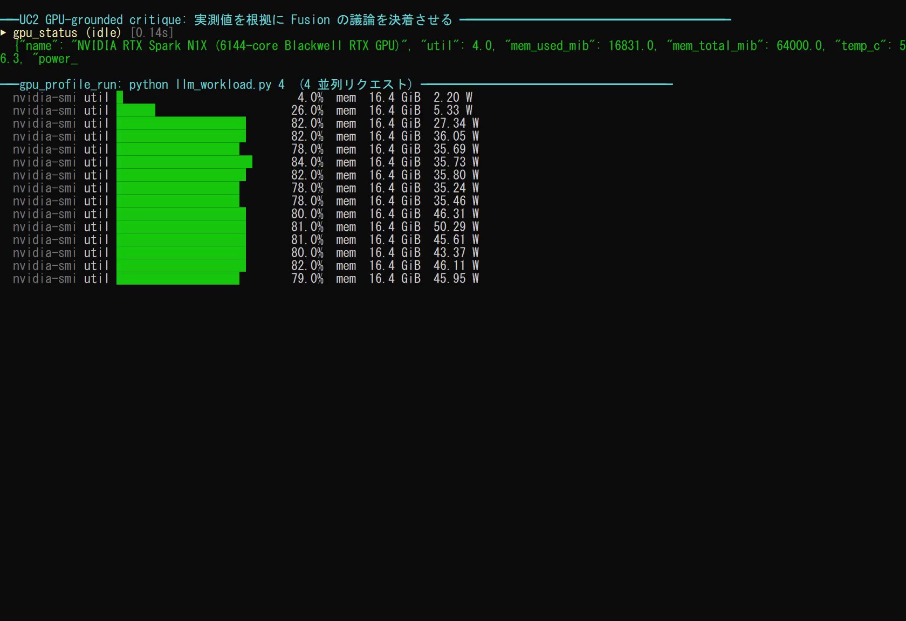
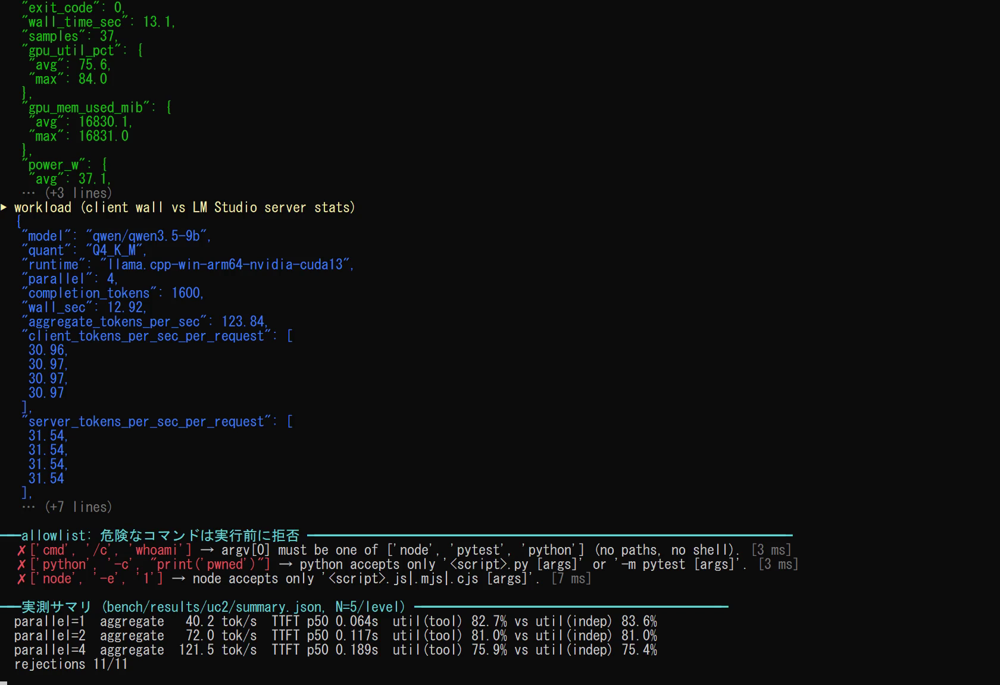
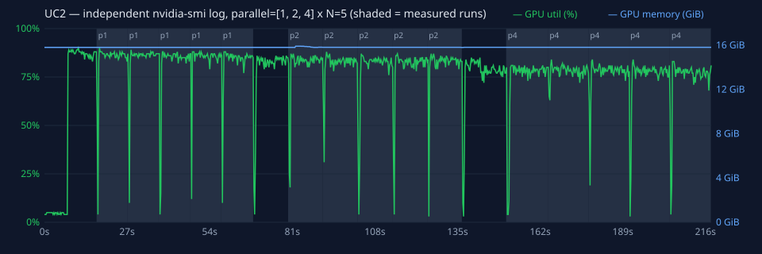

# UC2. GPU-Grounded Critique — 推測ではなく実測で最適化する

## ひとことで言うと

ベンチマークやテストを `gpu_profile_run` で実行し、その間の **GPU 使用率・メモリ・温度・電力・実行時間**を `nvidia-smi` で計測します。Copilot Fusion Max の Critique ループでは、この実測値だけを根拠に「変更を採用するか、元に戻すか」を決めます。

## エンジニアが興奮する理由

- **「AI は速くなると言ったが、実際は遅くなった」を構造的に防げます。** 変更のたびに同じ条件で計測し、前後の数値で判断するため、もっともらしいが間違った提案が残りません。
- **最適化の自律ループを手元の Blackwell GPU で回せます。** 仮説 → 変更 → 計測 → 採否を最大 3 回繰り返すので、人間は最終結果と根拠の数値を確認するだけで済みます。
- **GPU の使われ方が見えます。** 実行時間だけでなく、使用率の平均と最大、メモリの最大値もわかるので、「GPU が遊んでいる」「メモリが足りない」といった原因の当たりを付けられます。
- **統合メモリならではの調整ができます。** CPU と GPU が同じメモリを使う RTX Spark で、バッチサイズ、量子化、コンテキスト長などがどう効くかを実機で確かめられます。

## 向いている場面

- ローカル LLM 推論の tokens/sec を上げる（バッチ、量子化、プロンプト長、並列数）
- PyTorch / CUDA カーネルの最適化
- テストスイートや学習ステップの高速化
- 「この変更で GPU メモリ使用量が増えていないか」の回帰チェック

## 使うもの

| 区分 | 内容 |
|---|---|
| Fusion effort | **Max**（Critique パターンで、別モデルが実測値をもとに提案を批評する） |
| spark-vibe ツール | `gpu_status`、`gpu_profile_run` |
| ローカルモデル | 不要（計測対象のプログラムが GPU を使う） |
| プロンプト | [`/uc2-gpu-grounded-critique`](../../.github/prompts/uc2-gpu-grounded-critique.prompt.md) |

## 流れ

```
[1] gpu_status       ── 開始時の GPU 状態を記録（他の負荷がないか確認）
[2] gpu_profile_run  ── ベースラインを計測
        │
   ┌────▼──────────────────────────────────────────┐
   │ [3] 仮説を 1 つ立て、変更を 1 つだけ加える     │
   │ [4] gpu_profile_run で再計測し、差分表を作る   │  最大 3 回
   │ [5] 数値だけで採否を判断。悪化したら元に戻す   │
   └────┬──────────────────────────────────────────┘
[6] 採用した変更と、根拠となる数値を報告
```

変更を 1 回に 1 つだけにするのは、どの変更が効いたのかを数値で切り分けるためです。

## 使い方

### 事前準備: 計測してよいフォルダーを登録する

`gpu_profile_run` は、許可されたフォルダー（`SPARK_PROFILE_ROOTS`）の中にあるスクリプトとテストしか実行しません。既定ではこのキットのフォルダーだけです。自分のプロジェクトを測るときは、先に登録してください。

```powershell
pwsh -File .\scripts\setup.ps1 -ProfileRoots C:\src\my-inference-app -SkipModelLoad
```

プロジェクト専用の venv を使う場合は、`mcp.json` / `mcp-config.json` の `spark-vibe.env` に `SPARK_PROFILE_PYTHON` を追加します。

```json
"env": {
  "SPARK_PROFILE_ROOTS": "C:\\Work\\Temp\\spark-fusion-vibe;C:\\src\\my-inference-app",
  "SPARK_PROFILE_PYTHON": "C:\\src\\my-inference-app\\.venv\\Scripts\\python.exe"
}
```

設定を変えたら MCP サーバーを再起動します（VS Code では **MCP: List Servers** → `spark-vibe` → **Restart**）。

### VS Code

1. モデルピッカーで **Copilot Fusion**、effort **Max** を選びます。
2. チャット欄に `/uc2-gpu-grounded-critique` と入力します。
3. 入力欄に次を入れます。
   - `target`: 最適化したいこと（例: 「`bench_llm.py` の tokens/sec を上げたい」）
   - `argv`: 実行するコマンドの**配列**（例: `["python", "bench_llm.py"]`）
   - `cwd`: 作業フォルダーの**絶対パス**（例: `C:\Work\Temp\spark-fusion-vibe\demo`）

### 指定できるコマンドの形

| 形式 | 例 |
|---|---|
| Python スクリプト | `["python", "bench.py", "--batch", "8"]` |
| pytest（モジュール指定） | `["python", "-m", "pytest", "tests/test_perf.py", "-q"]` |
| pytest | `["pytest", "-k", "fast", "tests"]` |
| Node.js スクリプト | `["node", "bench.mjs"]` |

`cmd`、`powershell`、`.exe` のパス、`python -c`、`node -e`、外部のコードを読み込む pytest オプションなどは拒否されます。詳しくは [セキュリティモデル](../security.md#gpu_profile_run-の許可リスト) を参照してください。

## デモでの実行例

`demo/bench_llm.py` は、ローカル LLM に 400 トークンを生成させて tokens/sec を出力するベンチマークです。

呼び出し:

```json
{ "argv": ["python", "bench_llm.py"], "cwd": "C:\\Work\\Temp\\spark-fusion-vibe\\demo", "interval_sec": 0.3 }
```

実際の結果（2026-11-10、この端末で実行。数値は実行ごとに変わります）:

```json
{
  "argv": [
    "C:\\Work\\Temp\\spark-fusion-vibe\\.venv\\Scripts\\python.exe",
    "C:\\Work\\Temp\\spark-fusion-vibe\\demo\\bench_llm.py"
  ],
  "exit_code": 0,
  "wall_time_sec": 10.125,
  "samples": 25,
  "gpu_util_pct": { "avg": 84.5, "max": 89.0 },
  "gpu_mem_used_mib": { "avg": 16114.0, "max": 16114.0 },
  "temp_c": { "avg": 65.2, "max": 68.24 },
  "power_w": { "avg": 35.7, "max": 46.03 },
  "output_tail": "{\"model\": \"qwen/qwen3.5-9b\", \"completion_tokens\": 400, \"seconds\": 9.94, \"tokens_per_sec\": 40.2}\n"
}
```

読み方:

- `argv` には、サーバー側で決めた実際の実行ファイル（venv の Python）と、絶対パスに解決したスクリプトが入ります。
- GPU 使用率が平均 84.5% と高く、qwen3.5-9b の生成で GPU がよく使われていることがわかります。
- メモリ 16,114 MiB は、常駐している 3 モデル（約 13GB）と KV キャッシュなどを含む GPU 全体の使用量です。
- `output_tail` から tokens/sec（40.2）を読み取り、比較の主指標にします。

許可リスト外のコマンドを渡すと、何も実行せずに次のように返ります。

```json
{
  "rejected": true,
  "reason": "argv[0] must be one of ['node', 'pytest', 'python'] (no paths, no shell).",
  "argv": ["cmd", "/c", "whoami"],
  "allowed_roots": ["C:\\Work\\Temp\\spark-fusion-vibe"]
}
```

### 最終レポートの形式

プロンプトは、最後に次の形の表を出すよう指示しています（ベースラインは上の実測値。変更後の列は Fusion が埋めます）。

| 指標 | ベースライン | 変更後 | 変化率 |
|---|---|---|---|
| tokens/sec（`output_tail` から） | 40.2 | … | … |
| wall time | 10.125 s | … | … |
| GPU 使用率 avg / max | 84.5% / 89.0% | … | … |
| GPU メモリ max | 16,114 MiB | … | … |
| 電力 avg | 35.7 W | … | … |

判断の基準は「主指標（この例では tokens/sec）が改善し、メモリや電力の悪化が許容範囲であれば採用。そうでなければ元に戻す」です。

<!-- BEGIN:measured (generated by bench/report.py) -->
## 実測結果（各並列度 N=5、ウォームアップ 1 回除外）

計測ハーネス: [`bench/uc2_bench.py`](../../bench/uc2_bench.py)、負荷: [`bench/llm_workload.py`](../../bench/llm_workload.py) ／ 生データ: [`bench/results/uc2/`](../../bench/results/uc2/)

モデル `qwen/qwen3.5-9b`（Q4_K_M）、ランタイム `llama.cpp-win-arm64-nvidia-cuda13`、各リクエスト最大 400 トークン。`gpu_profile_run` の中で負荷を動かし、同時に別プロセスの `nvidia-smi` でも記録しました。

### 並列リクエストでの伸び

| 並列数 | 合計 tok/s 中央値（p95 / SD） | 1 本あたり tok/s（クライアント計測） | 1 本あたり tok/s（LM Studio サーバー計測） | TTFT 中央値（p95） | 倍率 |
|---|---|---|---|---|---|
| 1 | 40.2（40.6 / 0.46） | 40.3 | 40.7 | 64 ms（77 ms） | ×1.00 |
| 2 | 72.0（72.3 / 0.18） | 36.1 | 36.8 | 117 ms（158 ms） | ×1.79 |
| 4 | 121.5（124.0 / 1.31） | 30.5 | 31.2 | 189 ms（221 ms） | ×3.02 |

### ツールの数値は信用できるか（独立ログとの突き合わせ）

| 並列数 | GPU 使用率 平均（ツール） | GPU 使用率 平均（独立 nvidia-smi） | 差の中央値（最大） | メモリ最大（ツール / 独立） | 平均電力 |
|---|---|---|---|---|---|
| 1 | 82.7% | 83.6% | 0.9 pt（1.3 pt） | 16174 / 16174 MiB | 47.3 W |
| 2 | 81.0% | 81.0% | 0.9 pt（2.1 pt） | 16184 / 16184 MiB | 36.8 W |
| 4 | 75.9% | 75.4% | 0.7 pt（1.8 pt） | 16184 / 16184 MiB | 39.6 W |

アイドル時（5 秒）: 使用率 5%、メモリ 16174 MiB（モデルは常駐済み）、電力 2.2 W。

### 危険なコマンドの拒否（11/11 件拒否）

| 攻撃 | 結果 | 理由 | 応答 |
|---|---|---|---|
| shell launcher | 拒否 | argv[0] must be one of ['node', 'pytest', 'python'] (no paths, no shell). | 5.8 ms |
| powershell | 拒否 | argv[0] must be one of ['node', 'pytest', 'python'] (no paths, no shell). | 2.7 ms |
| absolute exe path | 拒否 | argv[0] must be one of ['node', 'pytest', 'python'] (no paths, no shell). | 3.1 ms |
| python -c | 拒否 | python accepts only '<script>.py [args]' or '-m pytest [args]'. | 4.5 ms |
| python -m other | 拒否 | python accepts only '<script>.py [args]' or '-m pytest [args]'. | 2.9 ms |
| script outside roots | 拒否 | '..\..\..\outside.py' is not an existing file under the allowed roots. | 3.8 ms |
| non-.py script | 拒否 | 'README.md' must be a .py file. | 2.0 ms |
| pytest plugin | 拒否 | pytest option '-p' is not allowed. | 2.4 ms |
| pytest target outside | 拒否 | pytest target 'C:\WINDOWS' is outside the allowed roots. | 3.0 ms |
| node eval | 拒否 | node accepts only '<script>.js|.mjs|.cjs [args]'. | 4.3 ms |
| cwd outside roots | 拒否 | cwd 'C:\WINDOWS' is not a directory under the allowed roots. | 2.0 ms |

### わかったこと

1. **並列にすると合計スループットが伸びます。** 1 本 40.2 tok/s → 4 本で 121.5 tok/s（×3.02）。1 本あたりの速度は少し落ちるだけなので、Fusion が複数の観点（性能・安全性・可読性など）を同時にローカルで問い合わせる使い方に向きます。
2. **ツールの GPU 数値は独立した計測と一致しました**（使用率の差は中央値で 1 ポイント未満）。クライアント計測とサーバー計測の tok/s の差も小さく、HTTP のオーバーヘッドはわずかです。
3. **メモリの増え方は小さい**: モデルは事前に読み込まれているため、実行中の増加は数〜百 MiB 程度です。合計値の大半は常駐モデルです。
4. 拒否はすべて実行前に数 ms で返りました。

**実行の録画**（実時間。MP4: [uc2-demo.mp4](../media/uc2-demo.mp4)）


| 途中 | 最後（実測サマリ） |
|---|---|
|  |  |

独立した `nvidia-smi` ログ（ツールとは別プロセスで 250 ms ごとに取得。網掛けは計測区間）:



<!-- END:measured -->

## うまく使うコツ

- **ベンチマークは結果を標準出力に出す**ようにしてください。末尾 3000 文字が `output_tail` に入り、Fusion が tokens/sec などを読み取れます。JSON 1 行で出すのがおすすめです。
- **1 回の実行は数秒〜数分**に収めます。短すぎるとサンプル数が少なく、統計がぶれます。`interval_sec`（既定 0.5 秒）を小さくすると細かく取れます。
- **ばらつきに注意します。** 差が数％なら、同じ条件で 2〜3 回測ってから判断するようプロンプトで指示してください。
- **他の GPU 負荷を止めます。** `gpu_status` で開始時の使用率を確認し、LM Studio で不要なモデルが動いていないか確かめます。

## 限界と注意

- `nvidia-smi` が測るのは **GPU 全体**の値です。対象プロセス以外の負荷も含まれます。
- サンプリング間隔は 0.1〜10 秒、タイムアウトは 1〜3600 秒に丸められます。
- 許可フォルダー内のスクリプトの中身は制限しません。信頼できるリポジトリだけを登録してください。
