# UC3. Local Visual Critic Loop — Iterate on UI with a Local VLM Reviewer

[日本語](uc3-visual-critic-loop.md) | English

## In a nutshell

Copilot Fusion implements a UI and takes a screenshot. A **local VLM on RTX Spark (`google/gemma-4-e4b`)** scores whether it meets the requirements. Fusion revises the UI based on that feedback and automatically repeats the loop until it passes.

## Why engineers get excited

- **Visual checks become free and unlimited.** Sending images to a cloud VLM every time adds up; locally, even dozens of iterations incur no additional fees.
- **Humans no longer become the bottleneck.** You do not need to inspect every “Is the button the right color?” or “Are the cards side by side?” check, so you can keep turning UI ideas into working screens.
- **It pairs well with Fusion Standard's Cascade.** Handle most iterations with a lightweight model plus local review, reserving stronger models for the difficult parts.
- **Screens stay on the device.** Review unreleased-product UIs and internal-system screens locally.

## Good fits

- Quickly building static UIs such as dashboards, admin screens, and landing pages
- Designs whose acceptance criteria (colors, layout, presence of elements) can be written in words
- Polishing UIs that need repeated small adjustments

It is not suitable for pixel-perfect matching or rigorous accessibility validation (see below).

## What you use

| Category | Details |
|---|---|
| Fusion effort | **Standard** (many iterations, so use Cascade with lightweight models for most work) |
| spark-vibe tools | `visual_review`, `local_critique` (optional first-pass code review) |
| Screenshot | Microsoft Edge headless mode (recommended), or Playwright MCP |
| Local models | Vision: `google/gemma-4-e4b`; chat: `qwen/qwen3.5-9b` |
| Prompt | [`/uc3-visual-critic-loop` — Japanese prompt source](../../.github/prompts/uc3-visual-critic-loop.prompt.md) |

## Workflow

```
   ┌──────────────────────────────────────────────────────────┐
   │ [1] Implement/revise HTML/CSS                             │
   │ [2] Take a screenshot (Edge headless)                     │
   │ [3] visual_review(image, acceptance criteria)             │  Up to 5 times
   │       → {"verdict","score","issues","suggestions"}         │
   │ [4] Apply only valid feedback to the next revision        │
   └──────────────┬───────────────────────────────────────────┘
   [5] Stop at verdict=pass and score≥8, or after 5 iterations
   [6] Report score progression and accepted/rejected feedback
```

## How to use it

### VS Code

1. In the model picker, select **Copilot Fusion**, effort **Standard**.
2. Enter `/uc3-visual-critic-loop` in chat.
3. Fill in:
   - `design`: the UI and acceptance criteria (for example, “Dark theme, title 'RTX Spark Dashboard', 3 cards in one row for GPU usage, unified memory, and tokens/sec, plus a blue benchmark button”)
   - `htmlPath`: the **absolute path** for the HTML output

### Taking screenshots

Edge headless mode is the most reliable option.

```powershell
& "C:\Program Files (x86)\Microsoft\Edge\Application\msedge.exe" `
  --headless=new --disable-gpu --window-size=1200,600 `
  --screenshot=C:\Work\Temp\spark-fusion-vibe\demo\ui\screenshot.png `
  file:///C:/Work/Temp/spark-fusion-vibe/demo/ui/index.html
```

- Match `--window-size` to the intended viewport (for example, `390,844` for mobile).
- With Playwright MCP, ensure a tool that can save an image file is enabled. If saving is unavailable, use Edge headless.

### Writing acceptance criteria

VLMs are good at judging what can be seen. Write criteria as **specific, visually verifiable facts**.

| Good example | Poor example |
|---|---|
| “The background is dark gray or black” | “A modern feel” |
| “3 cards appear in one horizontal row” | “An easy-to-read layout” |
| “A blue button at the bottom right labeled 'Run benchmark'” | “A prominent CTA” |
| “Each card has a value and unit (%, GB, tok/s)” | “Clear information” |

## Demo execution example

Call:

```json
{
  "image_path": "C:\\Work\\Temp\\spark-fusion-vibe\\demo\\ui\\screenshot.png",
  "expectation": "Dark dashboard titled 'RTX Spark Dashboard' with 3 metric cards in one row (GPU usage, unified memory, tokens/sec) and a blue benchmark button."
}
```

The target screenshot (`demo/ui/screenshot.png`) has a dark background, the title “RTX Spark Dashboard,” 3 cards (GPU usage / unified memory / tokens/sec) **in one horizontal row**, and a blue “Run benchmark” button below them (labels translated here from the recorded Japanese UI). It meets all the acceptance criteria.

Actual result from the old `mode="holistic"` approach (run on this device on 2026-11-10; the current default is `checklist`. Compare with the repeated measurements below):

```json
{
  "verdict": "fail",
  "score": 6,
  "issues": [
    "The layout is not fully optimized for modern dashboard design; the metric cards are stacked vertically in relation to the button placement.",
    "The title 'RTX Spark Dashboard' is present but could benefit from better visual hierarchy or branding integration.",
    "The blue benchmark button is placed awkwardly below the first card, breaking the intended row structure of metrics and actions."
  ],
  "suggestions": [
    "Arrange the three metric cards (GPU usage, Unified Memory, Tokens/sec) in a single horizontal row as per the acceptance criteria.",
    "Place the 'Benchmark' button logically. ...",
    "Ensure consistent visual weight and spacing between the three metric cards to create a clean, balanced dashboard feel."
  ]
}
```

### Interpreting this result (an example of not trusting it blindly)

The VLM returned `fail` for a screen that met the criteria. Comparing its feedback with those criteria:

| Feedback | Decision | Reason |
|---|---|---|
| The cards are stacked vertically | **Reject** | The image shows 3 cards in one horizontal row (misrecognition) |
| The title's visual hierarchy could be improved | **Reject** | The criterion only requires a title, which is present |
| The button is below the first card and breaks the row structure | **Reject** | The criteria do not specify button placement |

Small VLMs can report nonexistent problems or introduce preferences not in the criteria. The prompt therefore instructs Fusion to **accept or reject feedback against the criteria**. If no feedback is worth accepting, it is fine to stop there and ask a human or stronger model to check.

To reduce false positives, split acceptance criteria into yes/no questions (for example, “Are the 3 cards side by side at the same height?”).

### Final report format

The prompt requests a final table in this format:

| Iteration | verdict | score | Accepted feedback | Rejected feedback (reason) |
|---|---|---|---|---|
| 1 | fail | 6 | — | “Cards are stacked vertically” (misrecognition), plus 2 other items |
| … | … | … | … | … |

## Combining with `local_critique`

The UI code itself (HTML/CSS/JS) can also receive a local first-pass review before being sent to the cloud.

```json
{ "requirement": "Clicking the button calls /api/bench and displays the results in the cards", "candidate": "<script>...</script>" }
```

If the return value is `{"accept": false, "problems": [...]}`, fix the code before passing it to a stronger model (a gate before Cascade).

<!-- BEGIN:measured (translated-source: uc3-visual-critic-loop.md) -->
## Measured results (N=5 per image; warm-up excluded)

Harness: [`bench/uc3_bench.py`](../../bench/uc3_bench.py) / Raw data: [`bench/results/uc3/`](../../bench/results/uc3/).

**Ground truth**: We automatically generated 2 screens meeting the criteria and 5 screens each breaking **exactly 1** criterion, labeling them at generation time. A “correct reason” means `issues` mentions the actual defect (for example, a red button → `red`).

The English UI fixtures below were rerendered fully in English. They are presentation assets, not new measurements: all scores remain those measured with the original Japanese fixtures. See [English media provenance](../media/en/README.en.md).

| pass_original | pass_other_values | fail_stacked | fail_two_cards |
|---|---|---|---|
| 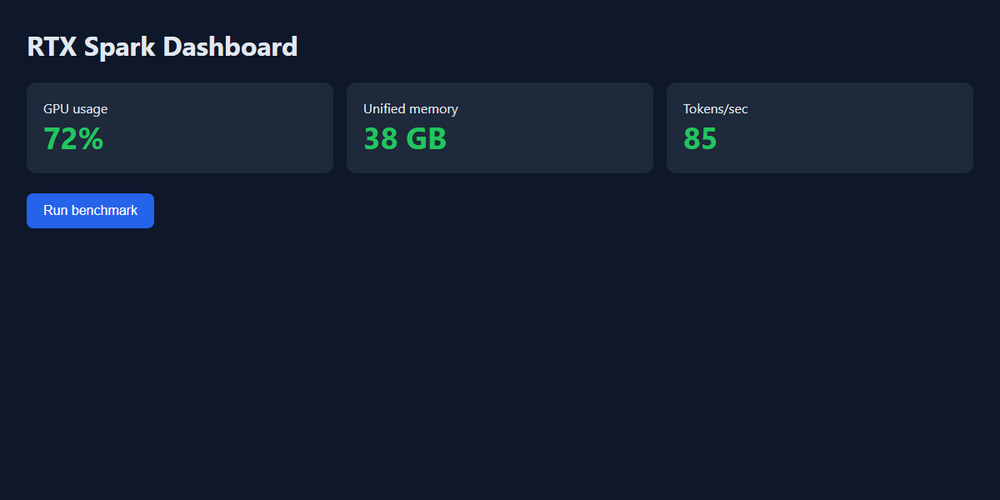 | 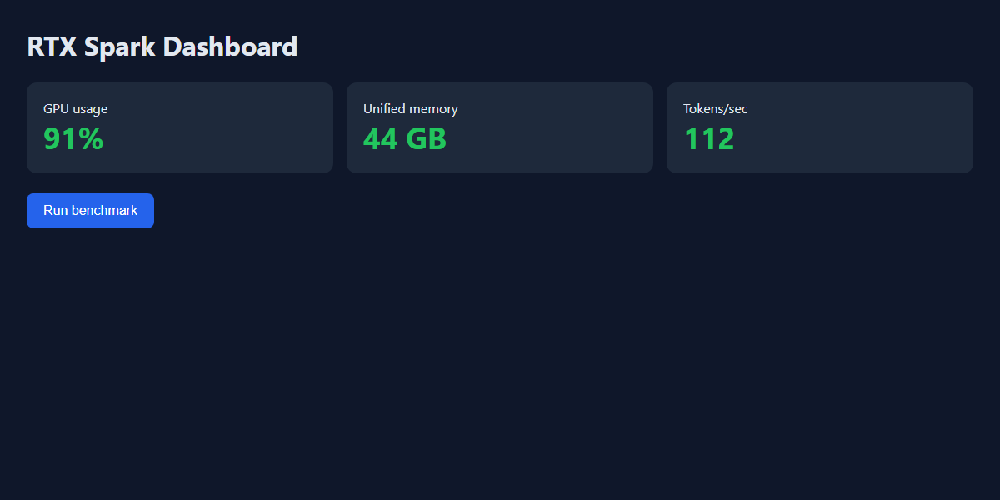 | 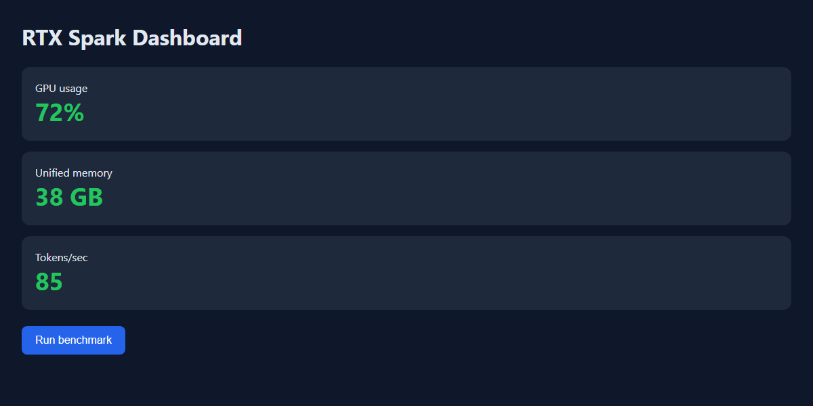 | 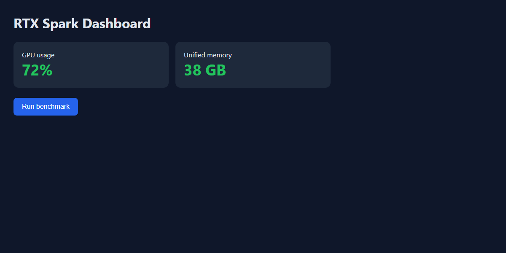 |
| **fail_red_button** | **fail_wrong_title** | **fail_light_theme** | |
| 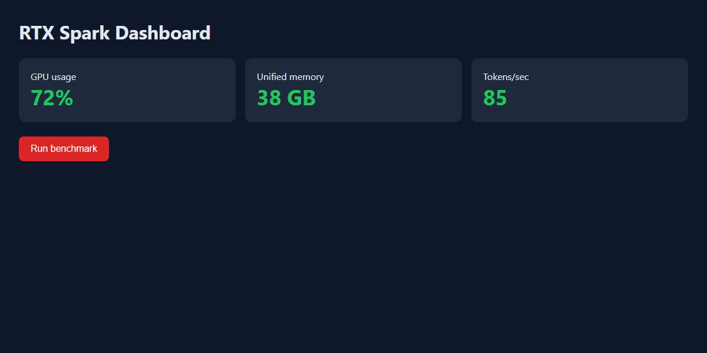 | 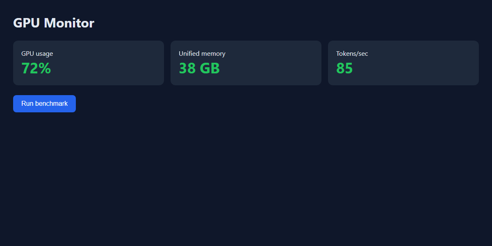 | 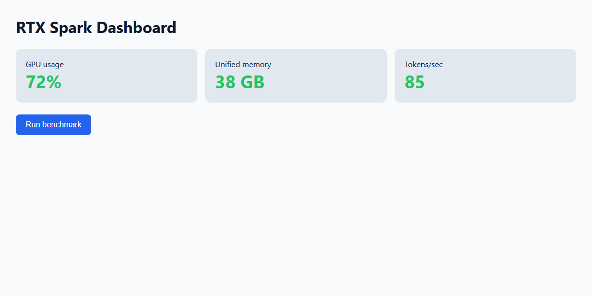 | |

### `visual_review` accuracy

| Method | Accuracy | Defect detection rate | False-positive rate (passing screen marked fail) | Correct-reason rate | Median / p95 |
|---|---|---|---|---|---|
| holistic (old: overall judgment) | 71% | 100% | 100% | 84% | 4.80 / 6.24 s (SD 0.71) |
| checklist (default: observe → judge each criterion) | 86% | 100% | 50% | 100% | 7.54 / 8.86 s (SD 0.71) |
| checklist + clarified criteria | 100% | 100% | 0% | 100% | 6.97 / 12.21 s (SD 5.23) |

Confusion matrix (positive = defect present):

| Method | TP | TN | FP | FN | Unparseable |
|---|---|---|---|---|---|
| holistic | 25 | 0 | 10 | 0 | 0 |
| checklist | 25 | 5 | 5 | 0 | 0 |
| checklist_clarified | 25 | 10 | 0 | 0 | 0 |

Number of fail verdicts per image (out of N runs):

| Image | Ground truth | holistic | checklist | checklist_clarified |
|---|---|---|---|---|
| pass_original | pass | 5/5 | 2/5 | 0/5 |
| pass_other_values | pass | 5/5 | 3/5 | 0/5 |
| fail_stacked | fail | 5/5 | 5/5 | 5/5 |
| fail_two_cards | fail | 5/5 | 5/5 | 5/5 |
| fail_red_button | fail | 5/5 | 5/5 | 5/5 |
| fail_wrong_title | fail | 5/5 | 5/5 | 5/5 |
| fail_light_theme | fail | 5/5 | 5/5 | 5/5 |

### `local_critique` accuracy (3 correct + 3 buggy code examples; N=5 each)

| Accuracy | Bug detection rate | False-positive rate | Median / p95 |
|---|---|---|---|
| 97% | 100% | 0% | 0.84 / 3.58 s (SD 1.20) |

TP=14 / TN=15 / FP=0 / FN=0 / unparseable=1. Detection and false-positive rates use parseable responses only. Accuracy includes unparseable responses in its denominator. Across all buggy cases, including invalid JSON, detection was 14/15.

Cases: an average that divides by 0 for an empty list, a leap-year check missing the 100/400-year rules, and SQL injection via an f-string (plus the correct version of each).

### Findings

1. **The old approach failed everything.** It returned fail for every passing screen (100% false-positive rate), with scores stuck at 5–6, making it unsuitable for deciding acceptance. The cause was the instruction to be a “strict UI/UX reviewer,” which treated preferences outside the criteria (such as button placement) as grounds for failure.
2. **Having the model write “what I see → judgment” for each criterion, with code determining the final verdict (checklist, the default)** reduced the false-positive rate to 50% and raised the correct-reason rate to 100%. Processing time increased from 4.8 seconds to 7.5 seconds.
3. **The remaining false positives came from how the criteria were written.** English criteria ('GPU usage') were judged not to match the Japanese label (meaning “GPU usage”). Adding “Labels may be in Japanese” reduced the false-positive rate to 0%. **Write criteria in the screen's language or explicitly allow translations.**
4. `local_critique` achieved 97% accuracy; 1/30 responses could not be parsed as JSON (median 0.84 seconds). Do not treat unparseable output as a pass: retry or request human review.
5. **Scoring-rule revision disclosed.** The correct-reason rate is a conservative lower bound assessed with regular expressions. After inspecting outputs, we broadened 1 expression for `fail_two_cards` because it missed “two **visible** metric cards.” We did not rerun the model; `uc3_bench.py --rescore` rescored `raw.jsonl`. Verdict totals are unchanged. The pre-revision summary is retained in [`summary.pre-rescore.json`](../../bench/results/uc3/summary.pre-rescore.json).
6. This is a small sample of 7 fixed images and 6 code examples. 100% is not a guarantee of general accuracy.

**Execution recording** (real time; MP4: [uc3-demo.mp4](../media/en/uc3-demo.mp4)). English MP4/PNG media uses pixel-row translations of the original recording with a visible provenance footer; GIFs derive from those edits. Already-English SVGs are unchanged. These are not new measurements; scores remain those of the original Japanese fixtures. See [English media provenance](../media/en/README.en.md).

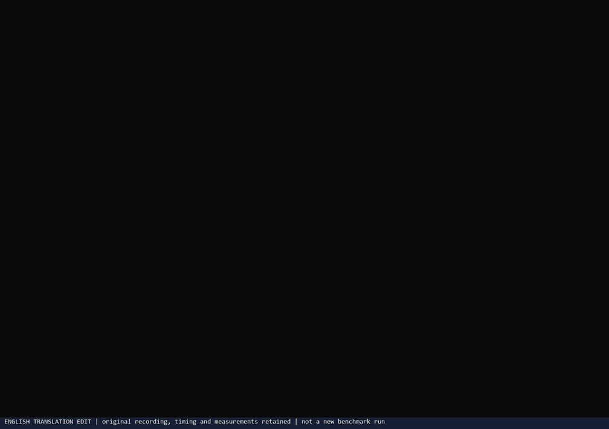

| In progress | Final (measurement summary) |
|---|---|
| 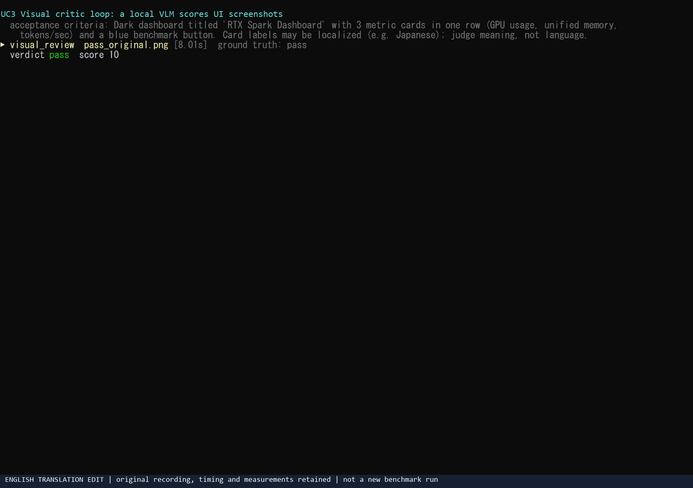 | 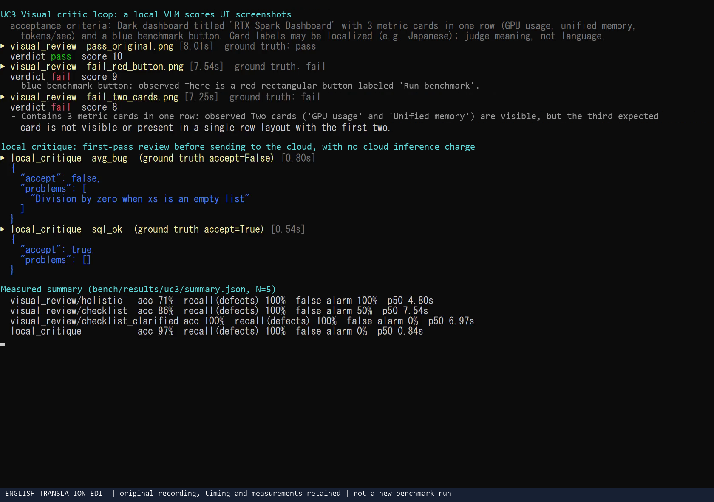 |

Independent `nvidia-smi` log (sampled every 250 ms in a process separate from the tool; shading marks measurement intervals):

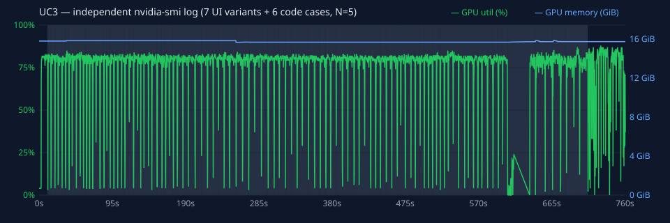

<!-- END:measured -->

## Tips

- **Treat VLM feedback as a signal.** A small, roughly 4B-class VLM can report nonexistent problems. The prompt also says to accept only feedback valid against the acceptance criteria.
- **Limit criteria to 5–7 items.** Too many make judgments unstable.
- **Fix the screen size.** Scores are not comparable unless every screenshot uses the same `--window-size`.

## Limits and cautions

- Pixel-perfect matching, exact color codes, and font identification are weak areas. For strict comparisons, also use visual regression tests (image diffs).
- Use dedicated tools such as axe to validate accessibility (contrast ratios, screen-reader support).
- A human should make the final visual judgment.
