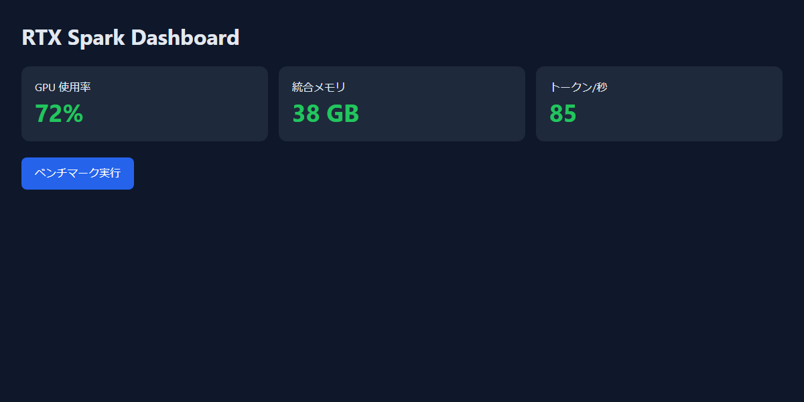
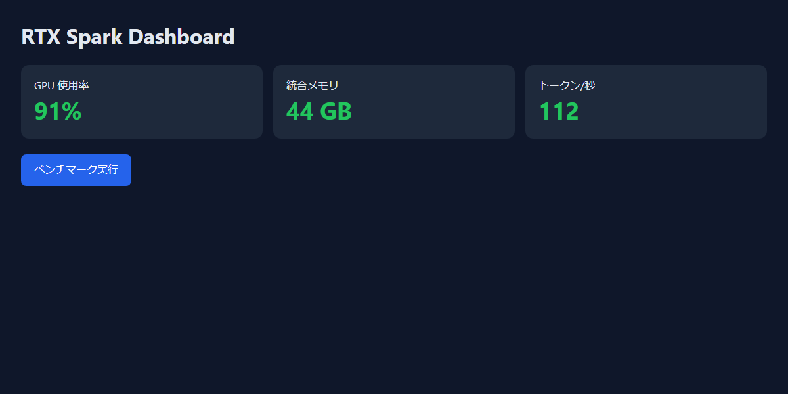
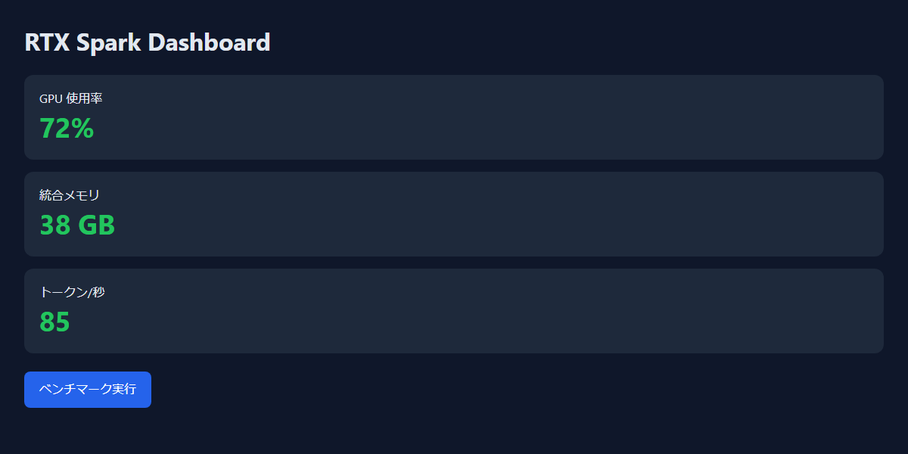
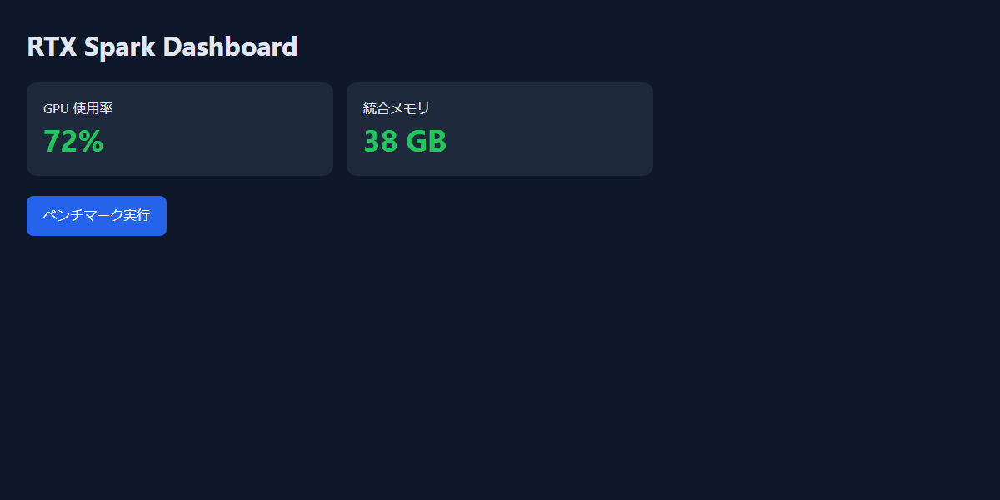
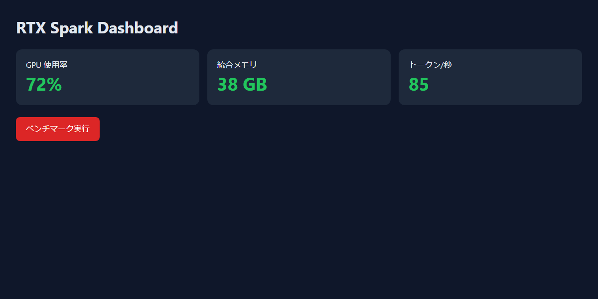
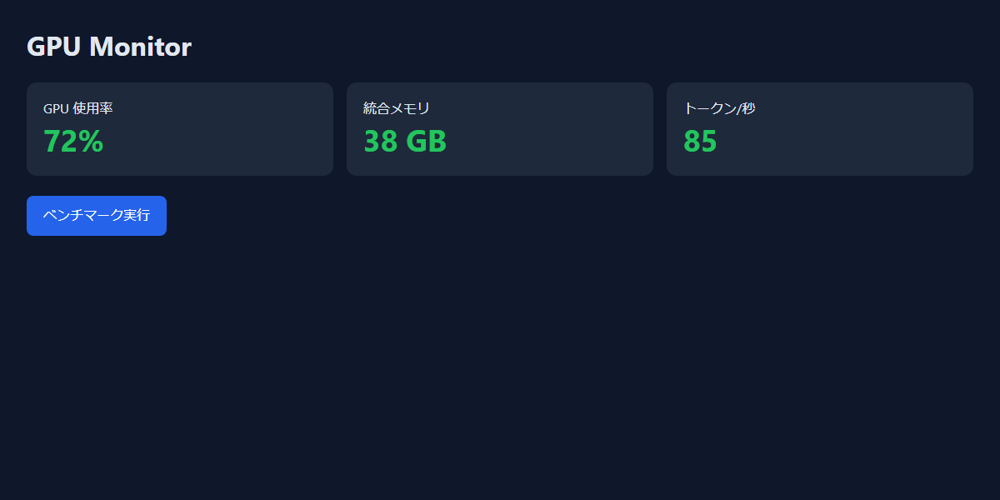
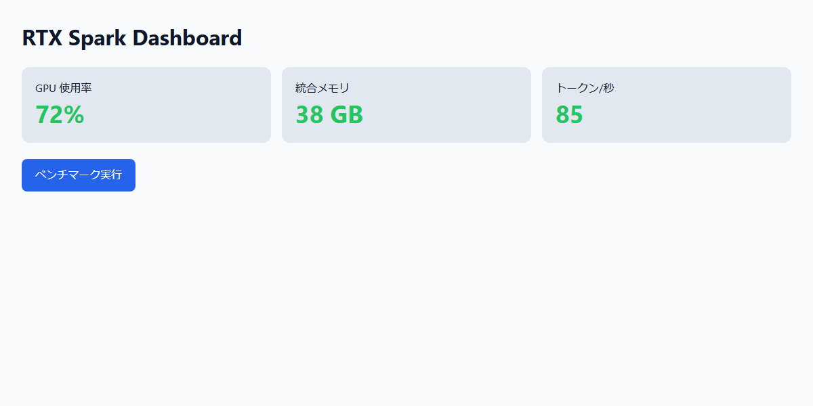
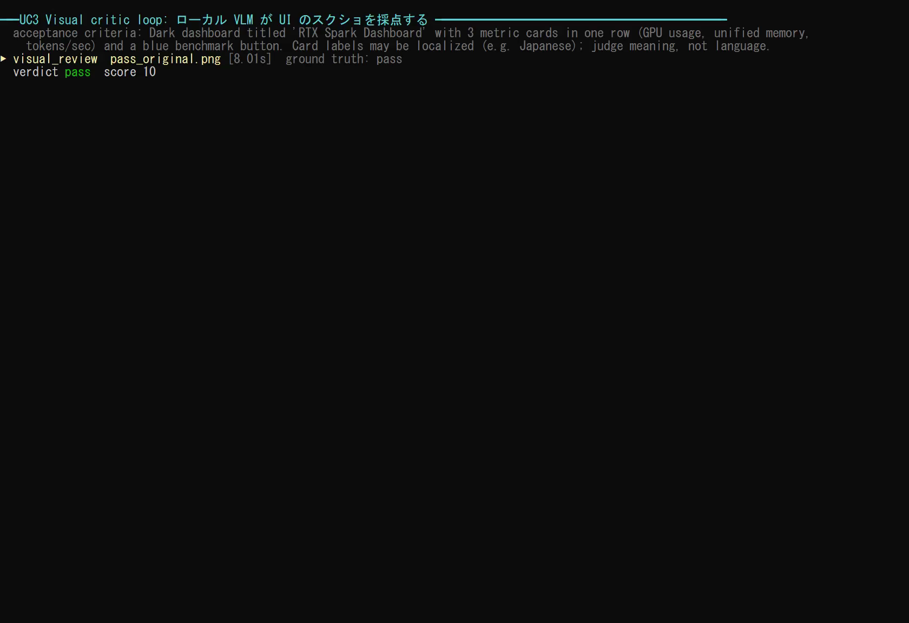
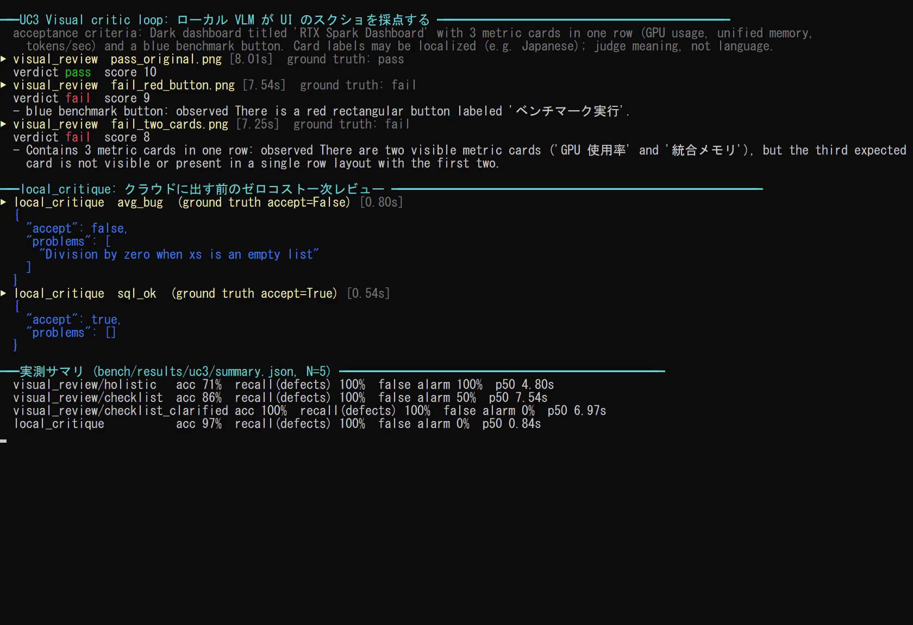
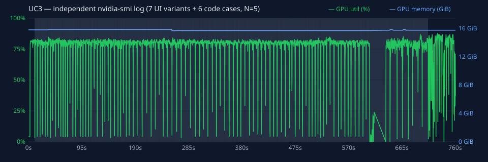

# UC3. Local Visual Critic Loop — UI をローカル VLM に審査させて反復する

## ひとことで言うと

Copilot Fusion が UI を実装し、スクリーンショットを撮り、**RTX Spark 上のローカル VLM（`google/gemma-4-e4b`）** が「要件どおりか」を採点します。その指摘をもとに修正し、合格するまでこのループを自動で回します。

## エンジニアが興奮する理由

- **見た目の確認が無料・無制限になります。** クラウドの VLM に毎回画像を送るとコストがかさみますが、ローカルなら何十回回しても追加料金はかかりません。
- **人間がボトルネックになりません。** 「ボタンの色は合っている？」「カードは横に並んでいる？」の確認を人が毎回見る必要がなくなり、思いついた UI を次々と形にできます。
- **Fusion Standard の Cascade と相性が良いです。** 反復の大半を軽量モデル＋ローカル審査で済ませ、難しいところだけ上位モデルに任せられます。
- **画面が外に出ません。** 未発表製品の UI や社内システムの画面も、端末内で審査できます。

## 向いている場面

- ダッシュボード、管理画面、LP などの静的な UI を素早く作る
- デザインの受け入れ基準（配色、レイアウト、要素の有無）が文章で書ける
- 何度も微調整が必要な UI の作り込み

ピクセル単位のデザイン一致や、アクセシビリティの厳密な検証には向いていません（後述）。

## 使うもの

| 区分 | 内容 |
|---|---|
| Fusion effort | **Standard**（反復回数が多いので、Cascade で軽量モデル中心に回す） |
| spark-vibe ツール | `visual_review`、`local_critique`（コードの一次レビューに任意で使う） |
| スクリーンショット | Microsoft Edge の headless モード（推奨）、または Playwright MCP |
| ローカルモデル | 画像 `google/gemma-4-e4b`、チャット `qwen/qwen3.5-9b` |
| プロンプト | [`/uc3-visual-critic-loop`](../../.github/prompts/uc3-visual-critic-loop.prompt.md) |

## 流れ

```
   ┌──────────────────────────────────────────────────────┐
   │ [1] HTML/CSS を実装・修正                              │
   │ [2] スクリーンショットを撮る（Edge headless）           │
   │ [3] visual_review(画像, 受け入れ基準)                   │  最大 5 回
   │       → {"verdict","score","issues","suggestions"}   │
   │ [4] 妥当な指摘だけを採用して次の修正に反映              │
   └──────────────┬───────────────────────────────────────┘
   [5] verdict=pass かつ score≥8、または 5 回で終了
   [6] score の推移表と、採用/却下した指摘を報告
```

## 使い方

### VS Code

1. モデルピッカーで **Copilot Fusion**、effort **Standard** を選びます。
2. チャット欄に `/uc3-visual-critic-loop` と入力します。
3. 入力欄に次を入れます。
   - `design`: 作りたい UI と受け入れ基準（例: 「ダークテーマで、タイトル 'RTX Spark Dashboard'、GPU 使用率・統合メモリ・tokens/sec の 3 枚のカードを横一列、青いベンチマークボタン」）
   - `htmlPath`: HTML の出力先の**絶対パス**

### スクリーンショットの撮り方

Edge の headless モードが最も確実です。

```powershell
& "C:\Program Files (x86)\Microsoft\Edge\Application\msedge.exe" `
  --headless=new --disable-gpu --window-size=1200,600 `
  --screenshot=C:\Work\Temp\spark-fusion-vibe\demo\ui\screenshot.png `
  file:///C:/Work/Temp/spark-fusion-vibe/demo/ui/index.html
```

- `--window-size` は実際に見せたい画面幅に合わせます（モバイルなら `390,844` など）。
- Playwright MCP を使う場合、画像ファイルとして保存できるツールが有効になっていることを確認してください。保存できない場合は Edge headless を使います。

### 受け入れ基準の書き方

VLM は「見てわかること」を判定するのが得意です。基準は**目で確認できる具体的な事実**として書きます。

| 良い例 | 悪い例 |
|---|---|
| 「背景は濃いグレーか黒」 | 「モダンな雰囲気」 |
| 「3 枚のカードが横一列に並ぶ」 | 「見やすいレイアウト」 |
| 「右下に青いボタン、ラベルは 'Run benchmark'」 | 「目立つ CTA」 |
| 「各カードに数値と単位（%, GB, tok/s）がある」 | 「情報がわかりやすい」 |

## デモでの実行例

呼び出し:

```json
{
  "image_path": "C:\\Work\\Temp\\spark-fusion-vibe\\demo\\ui\\screenshot.png",
  "expectation": "Dark dashboard titled 'RTX Spark Dashboard' with 3 metric cards in one row (GPU usage, unified memory, tokens/sec) and a blue benchmark button."
}
```

対象のスクリーンショット（`demo/ui/screenshot.png`）は、ダーク背景にタイトル「RTX Spark Dashboard」、3 枚のカード（GPU 使用率 / 統合メモリ / トークン/秒）が**横一列**、その下に青い「ベンチマーク実行」ボタンという画面です。受け入れ基準はすべて満たしています。

旧方式 `mode="holistic"` の実際の結果（2026-11-10、この端末で実行。現在の既定は `checklist`。下の反復実測と比較してください）:

```json
{
  "verdict": "fail",
  "score": 6,
  "issues": [
    "The layout is not fully optimized for modern dashboard design; the metric cards are stacked vertically in relation to the button placement.",
    "The title 'RTX Spark Dashboard' is present but could benefit from better visual hierarchy or branding integration.",
    "The blue benchmark button is placed awkwardly below the first card, breaking the intended row structure of metrics and actions."
  ],
  "suggestions": [
    "Arrange the three metric cards (GPU usage, Unified Memory, Tokens/sec) in a single horizontal row as per the acceptance criteria.",
    "Place the 'Benchmark' button logically. ...",
    "Ensure consistent visual weight and spacing between the three metric cards to create a clean, balanced dashboard feel."
  ]
}
```

### この結果の読み方（盲信しない例）

基準を満たしている画面に対して、VLM は `fail` を返しました。指摘を受け入れ基準と照らし合わせると、次のようになります。

| 指摘 | 判断 | 理由 |
|---|---|---|
| カードが縦に積まれている | **却下** | 画像では 3 枚が横一列に並んでいる（誤認） |
| タイトルの視覚的な階層を改善できる | **却下** | 基準は「タイトルがあること」だけで、満たしている |
| ボタンが最初のカードの下にあり、行の構造を崩している | **却下** | 基準はボタンの位置を指定していない |

このように、小型 VLM は存在しない問題を指摘したり、基準にない好みを持ち込んだりします。そのため、プロンプトでは指摘を**基準に照らして採否を判断する**よう指示しています。採用する指摘がなければ、その時点で人間か上位モデルに確認させて終了して構いません。

誤検知を減らすには、受け入れ基準を「はい / いいえ」で答えられる項目に分けて書くのが効果的です（例: 「3 枚のカードは同じ高さで横に並んでいるか」）。

### 最終レポートの形式

プロンプトは、最後に次の形の表を出すよう指示しています。

| 反復 | verdict | score | 採用した指摘 | 却下した指摘（理由） |
|---|---|---|---|---|
| 1 | fail | 6 | — | 「カードが縦に積まれている」（誤認）ほか 2 件 |
| … | … | … | … | … |

## `local_critique` との組み合わせ

UI のコード（HTML/CSS/JS）そのものも、クラウドに渡す前にローカルで一次レビューできます。

```json
{ "requirement": "ボタンを押すと /api/bench を呼び、結果をカードに表示する", "candidate": "<script>...</script>" }
```

戻り値 `{"accept": false, "problems": [...]}` なら、上位モデルに渡す前に直します（Cascade の前段の判定役）。

<!-- BEGIN:measured (generated by bench/report.py) -->
## 実測結果（各画像 N=5、ウォームアップ除外）

計測ハーネス: [`bench/uc3_bench.py`](../../bench/uc3_bench.py) ／ 生データ: [`bench/results/uc3/`](../../bench/results/uc3/)

**正解の作り方**: 基準を満たす画面 2 種と、基準を **1 つだけ** 壊した画面 5 種を自動生成し、生成時にラベルを付けました。「理由が正しい」は、`issues` が壊した箇所そのもの（例: 赤いボタン → `red`）に触れているかで判定します。

| pass_original | pass_other_values | fail_stacked | fail_two_cards |
|---|---|---|---|
|  |  |  |  |
| **fail_red_button** | **fail_wrong_title** | **fail_light_theme** | |
|  |  |  | |

### `visual_review` の判定精度

| 方式 | 正解率 | 欠陥の検出率 | 誤検知率（合格画面を fail） | 理由が正しい率 | 中央値 / p95 |
|---|---|---|---|---|---|
| holistic（旧方式: 総合判定） | 71% | 100% | 100% | 84% | 4.80 / 6.24 s（SD 0.71） |
| checklist（既定: 基準ごとに観察→判定） | 86% | 100% | 50% | 100% | 7.54 / 8.86 s（SD 0.71） |
| checklist + 基準を明確化 | 100% | 100% | 0% | 100% | 6.97 / 12.21 s（SD 5.23） |

混同行列（陽性 = 欠陥あり）:

| 方式 | TP | TN | FP | FN | 解析不能 |
|---|---|---|---|---|---|
| holistic | 25 | 0 | 10 | 0 | 0 |
| checklist | 25 | 5 | 5 | 0 | 0 |
| checklist_clarified | 25 | 10 | 0 | 0 | 0 |

画像ごとの fail 判定数（N 回中）:

| 画像 | 正解 | holistic | checklist | checklist_clarified |
|---|---|---|---|---|
| pass_original | pass | 5/5 | 2/5 | 0/5 |
| pass_other_values | pass | 5/5 | 3/5 | 0/5 |
| fail_stacked | fail | 5/5 | 5/5 | 5/5 |
| fail_two_cards | fail | 5/5 | 5/5 | 5/5 |
| fail_red_button | fail | 5/5 | 5/5 | 5/5 |
| fail_wrong_title | fail | 5/5 | 5/5 | 5/5 |
| fail_light_theme | fail | 5/5 | 5/5 | 5/5 |

### `local_critique` の判定精度（正しいコード 3 種 + バグ入りコード 3 種、各 N=5）

| 正解率 | バグの検出率 | 誤検知率 | 中央値 / p95 |
|---|---|---|---|
| 97% | 100% | 0% | 0.84 / 3.58 s（SD 1.20） |

TP=14 / TN=15 / FP=0 / FN=0 / 解析不能=1。検出率・誤検知率は解析できた応答に対する値です。正解率の分母には解析不能も含めます。不正 JSON を含むバグ全体に対する検出は 14/15 件です。

対象: 空リストで 0 除算する平均、100/400 年規則のないうるう年判定、f-string による SQL インジェクション（と、それぞれの正しい版）。

### わかったこと

1. **旧方式は「何でも fail」でした。** 合格画面にも毎回 fail を返し（誤検知率 100%）、スコアも 5〜6 に張り付くため、合否の判断材料になりません。原因は「厳しい UI/UX レビュアー」という指示で、基準にない好み（ボタンの配置など）まで不合格の理由にしていたことです。
2. **基準ごとに「見えたもの → 判定」を書かせ、合否はコードで決める方式（checklist、既定）**にしたところ、誤検知率は 50%、理由が正しい率は 100% になりました。代わりに処理時間は 4.8 秒から 7.5 秒に伸びます。
3. **残った誤検知の原因は、基準の書き方でした。** 英語の基準（'GPU usage'）と日本語のラベル（GPU 使用率）が一致しないとして fail にしていました。基準に「ラベルは日本語でもよい」と書き足すと、誤検知率は 0% になりました。**基準は画面の言語に合わせて書くか、翻訳を許すと明記してください。**
4. `local_critique` の正解率は 97%、JSON として読めなかった応答は 1/30 件でした（中央値 0.84 秒）。解析不能は合格扱いせず、再試行または人間の確認が必要です。
5. **採点ルールの修正を開示します。** 「理由が正しい」は正規表現で判定する保守的な下限です。出力を見た後、`fail_two_cards` の式を 1 か所広げました（"two **visible** metric cards" を取りこぼしていたため）。モデルは再実行せず、`uc3_bench.py --rescore` で raw.jsonl から再採点しています。verdict の集計は変わりません。修正前の集計は [`summary.pre-rescore.json`](../../bench/results/uc3/summary.pre-rescore.json) に残しています。
6. これは固定した 7 画像・6 コード例の小標本です。100% は一般的な正確さの保証ではありません。

**実行の録画**（実時間。MP4: [uc3-demo.mp4](../media/uc3-demo.mp4)）


| 途中 | 最後（実測サマリ） |
|---|---|
|  |  |

独立した `nvidia-smi` ログ（ツールとは別プロセスで 250 ms ごとに取得。網掛けは計測区間）:



<!-- END:measured -->

## うまく使うコツ

- **VLM の指摘は「シグナル」として扱います。** 4B 級の小型 VLM は、存在しない問題を指摘することがあります。プロンプトでも「受け入れ基準に照らして妥当なものだけ採用」と指示しています。
- **基準を 5〜7 個に絞ります。** 多すぎると判定が不安定になります。
- **画面サイズを固定します。** 毎回同じ `--window-size` で撮らないと、score が比較できません。

## 限界と注意

- ピクセル単位の一致、正確な色コード、フォントの種類の判定は苦手です。厳密な比較が必要ならビジュアルリグレッションテスト（画像差分）を併用してください。
- アクセシビリティ（コントラスト比、スクリーンリーダー対応）の検証には、axe などの専用ツールを使ってください。
- 最終的な見た目の判断は人間が行ってください。
